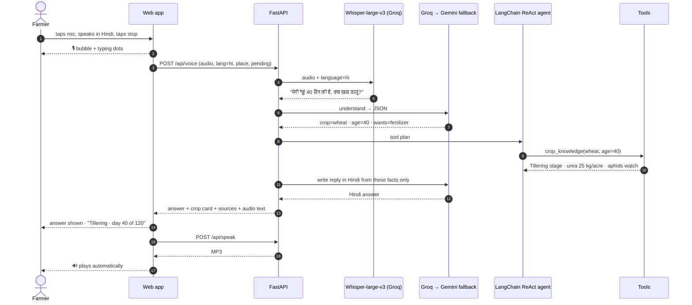
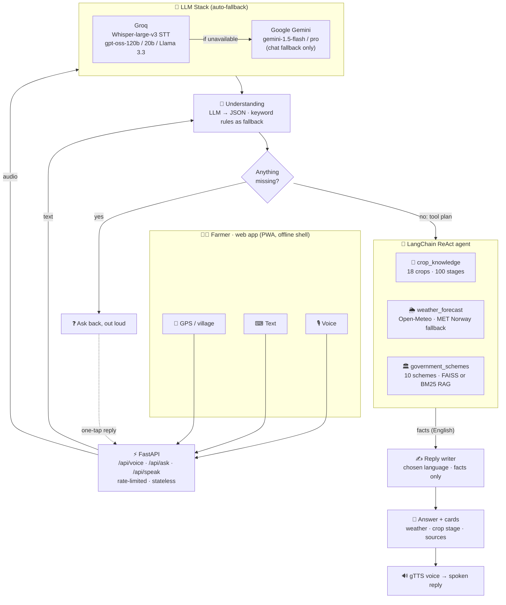

# Kisan Mitra — Multilingual Farm Advisory AI

**A voice-first agricultural assistant for Indian farmers, built for the field.**

Ask about your crop, the weather over your village, or a government scheme — in English, Hindi, Punjabi, or Marathi — and hear a short, grounded answer back in the same language.

[](https://multilingual-agri-ai-agent.onrender.com)
[](https://colab.research.google.com/github/sehscape/Multilingual-Agri-AI-Agent/blob/main/notebooks/run_full_app_colab.ipynb)


---

## Why this exists

India has over 140 million farming households. Expert advice — crop calendars, live weather, subsidy rules — exists, but it lives inside long documents and English-language portals. For a farmer who speaks only Marathi or Punjabi, or who doesn't read comfortably, that advice is out of reach.

Kisan Mitra is built around two ideas:

**1. Speaking and listening should be enough.**  
Every reply is read aloud. The assistant asks follow-up questions out loud — "how many days old is your wheat?" — with one-tap answers so no typing is needed. The whole interface (every label, error, and prompt) switches to whichever of the four languages the farmer picks.

**2. The AI is never the source of facts.**  
Fertilizer doses come from a curated crop knowledge base. Weather comes from a live API. Scheme rules come from official documents. The language model only understands the question and phrases what the tools found. If nothing reliable is found, it says so. A wrong dose can cost a farmer an entire season.

---

## What it can do

| Capability | Detail |
|---|---|
| 🎙️ Voice in 4 languages | Tap the mic, ask in English, Hindi, Punjabi, or Marathi; Whisper-large-v3 transcribes it |
| 🌱 Crop advice | 18 crops, 100 growth stages — fertilizer doses, irrigation, pest and disease control per stage |
| 🌦 Live weather | Current conditions and 3-day forecast for any village or city; asks for location if not saved |
| 🏛 Government schemes | 10 schemes with eligibility and application steps — PM-KISAN, Fasal Bima, KCC, KUSUM and more |
| 💬 Conversational ask-backs | Missing crop? Missing age? The assistant asks, with one-tap answers |
| 🔊 Spoken replies | Every answer is read aloud automatically, with play/pause |
| 📱 Phone-first | Large mic, GPS location, dark mode, installable as a home-screen app (PWA) |
| 🤖 Dual AI fallback | Groq LLM (primary) → Google Gemini (automatic fallback) — if one is down, the other answers |

---

## How it works

One question, end to end. Everything travels in a single `AgentState`, including `response_language` — the language the farmer picked, which every step respects.



---

## Architecture



**Key design:** the tools work in English. Language only matters at the edges — when the farmer's words arrive and when the answer goes out. That lets one knowledge base serve all four languages.

---

## AI Provider Strategy

The app uses **two API providers in sequence**, so a quota hit or outage on one never breaks the assistant:

| Provider | Role | What it handles |
|---|---|---|
| **Groq** (primary) | Voice + LLM | Whisper-large-v3 speech-to-text; gpt-oss-120b / gpt-oss-20b / Llama 3.3 for chat |
| **Google Gemini** (fallback) | LLM only | gemini-1.5-flash / gemini-1.5-pro — chat when Groq is rate-limited or down |

Both are free-tier with no credit card. If neither key is set the app still works — it answers from its rule engine in English, without voice.

**Which API is better for this project?**

> **Groq is the primary choice** because it provides Whisper-large-v3 for speech-to-text (which Gemini cannot do at all). Without Groq there is no microphone support. Gemini is the ideal fallback for the chat/understanding/reply-writing step — it has a generous free quota (60 req/min on Flash), understands Hindi and Marathi natively, and its JSON mode is reliable. Set both keys: Groq handles voice, Gemini catches overflow.

---

## Crops & Schemes

**18 crops across 100 growth stages** — each stage has irrigation needs, fertilizer dose per acre, things to watch for, and tips.

| Group | Crops |
|---|---|
| Cereals & millets | wheat · rice · maize · bajra · jowar |
| Pulses | chickpea · pigeon pea (tur/arhar) · moong |
| Oilseeds | soybean · mustard · groundnut |
| Cash crops | cotton · sugarcane |
| Vegetables & fruit | onion · tomato · potato · chilli · banana |

**10 government schemes**, each from its official description:

| Scheme | Benefit |
|---|---|
| PM-KISAN | ₹6,000/year in three instalments |
| PM Fasal Bima Yojana | Crop insurance at a low premium |
| Kisan Credit Card | Low-interest crop loans |
| Soil Health Card | Free soil test with fertilizer advice |
| PM-KUSUM | Solar pumps — 60%+ subsidy |
| PMKSY Per Drop More Crop | Drip/sprinkler — 55% subsidy for small farmers |
| PM Kisan Maandhan | ₹3,000/month pension after age 60 |
| e-NAM | Online mandi bidding, payment to bank |
| Crop Residue Management | 50% subsidy on stubble machines |
| Namo Shetkari Mahasanman Nidhi | Maharashtra extra ₹6,000/year |

---

## Quick Start

**Requirements:** Python 3.11. No GPU. Free API keys from [Groq](https://console.groq.com) and/or [Google AI Studio](https://aistudio.google.com/app/apikey).

```bash
git clone https://github.com/sehscape/Multilingual-Agri-AI-Agent.git
cd Multilingual-Agri-AI-Agent
python -m venv venv

# Windows
venv\Scripts\activate
# Linux / macOS
source venv/bin/activate

pip install -r requirements.txt
cp .env.example .env        # add GROQ_API_KEY and/or GEMINI_API_KEY
python scripts/build_scheme_index.py   # one-time FAISS index build
python app.py
```

Open http://127.0.0.1:7860 — the web app. The classic Gradio screen is at `/classic`. API docs at `/api/docs`.

<details>
<summary><b>Environment variables</b></summary>

| Variable | Default | Purpose |
|---|---|---|
| `GROQ_API_KEY` | — | Voice (Whisper) + primary LLM |
| `GROQ_LLM_MODELS` | `openai/gpt-oss-120b,…` | Groq models tried in order |
| `GEMINI_API_KEY` | — | Fallback LLM when Groq is unavailable |
| `GEMINI_LLM_MODELS` | `gemini-1.5-flash,…` | Gemini models tried in order |
| `LITE_MODE` | `false` | `true` on 512 MB hosts — no PyTorch, BM25 search |
| `AGENT_BACKEND` | `langchain` | `langchain` (ReAct) or `sequential` |
| `RAG_BACKEND` | `faiss` | `faiss` (semantic) or `bm25` (keyword) |
| `TTS_ENGINE` | `gtts` | `gtts`, `parler` (GPU), or `stub` |
| `DEV_MODE` | `true` | Adds full pipeline trace to each answer |

</details>

---

## Deployment on Render (free, 24/7)

The included `render.yaml` deploys the Lite build (no PyTorch, ~170 MB RAM) to Render's free tier:

1. Push this repo to GitHub.
2. Go to [render.com](https://render.com) → **New +** → **Web Service** → connect the repo.
3. Render reads `render.yaml` automatically.
4. In **Environment**, add:
   - `GROQ_API_KEY` — from [console.groq.com](https://console.groq.com)
   - `GEMINI_API_KEY` — from [aistudio.google.com](https://aistudio.google.com/app/apikey)
5. Click **Deploy**. When the log shows `Running on http://0.0.0.0:10000` the app is live.

> The free instance sleeps after ~15 min idle and wakes in 30–60 s on the next visit. Open the link a minute before a demo.

See [DEPLOY.md](DEPLOY.md) for the full step-by-step guide, free-tier limits, and upgrade path.

---

## API Reference

The web app is one client of a JSON API — a WhatsApp bot or Android app can use the same brain.

| Endpoint | Input | Output |
|---|---|---|
| `POST /api/ask` | `{text, lang, location, pending}` | answer, sources, cards, missing details |
| `POST /api/voice` | multipart: `audio` + `lang, location, pending` | same + `heard` (transcript) |
| `POST /api/speak` | `{text, lang}` | MP3 |
| `GET /api/config` | — | languages, all UI strings, sample questions, crop names |
| `GET /api/health` | — | which engines are active |

```bash
curl -s https://multilingual-agri-ai-agent.onrender.com/api/ask \
  -H "Content-Type: application/json" \
  -d '{"text": "My wheat is 40 days old — which fertilizer?", "lang": "hi"}'
```

---

## Project Structure

```
├── app/
│   ├── agents/       understanding · clarify · LangChain agent · orchestrator · reply writer · AgentState
│   ├── models/       groq_client · gemini_client · llm_client (unified fallback)
│   │                 stt · tts · translation (NLLB / IndicTrans2) · embeddings · glossary
│   ├── rag/          FAISS semantic search · BM25 keyword search
│   ├── tools/        crop · weather · scheme tools
│   ├── ui/           question pipeline · Gradio classic screen · i18n (4 languages)
│   ├── web/          FastAPI server · static web app (index.html · app.js · service worker)
│   ├── utils/        logging · audio conversion · device detection
│   ├── knowledge.py  crops & schemes registry — the single source of truth
│   ├── config.py     all settings read from .env
│   └── main.py       startup
├── data/
│   ├── crops/        one JSON file per crop
│   └── schemes/      schemes.json + raw/ scheme documents
├── notebooks/        Colab notebook (full build)
├── scripts/          test scripts · evaluation · latency benchmark · index builder
├── tests/            pytest unit tests
├── app.py            entry point
├── render.yaml       Render blueprint (Lite build)
├── requirements.txt       full build (with PyTorch)
└── requirements-lite.txt  Render free-tier build (no PyTorch)
```

---

## Safety & Honesty

| Guardrail | What it prevents |
|---|---|
| Facts only from tools | The LLM inventing doses, prices, or rules |
| `temperature=0` for understanding | Inconsistent or creative parsing |
| Relevance threshold 0.35 → refusal | Answering scheme questions from weak matches |
| BM25 two-word rule | Trusting one accidental keyword hit |
| Ask-backs + impossible-age check | Advising on "wheat, 300 days" |
| Hand-written farm glossary | "Tillering" machine-translated as "harvest" |
| Script check + one retry | Punjabi shown in the wrong alphabet |
| API key never logged | Key leak prevention |

---

## Limitations

- Everyone on the live link shares one Groq key (~50–60 full answers/day on gpt-oss-120b before the smaller model takes over).
- Voice clips go to Groq's servers. A production version should self-host Whisper.
- Crop guides (18 crops) and scheme documents (10 schemes) are hand-curated from standard package-of-practice guides. Doses are general — every answer reminds the farmer to check with their local KVK. Scheme amounts change, so the documents need a yearly review.

---

## Tech Stack

| Layer | Technology |
|---|---|
| Web app | Hand-written HTML/CSS/JS (~35 KB) · MediaRecorder · Web Audio · PWA service worker |
| API | FastAPI + uvicorn · per-visitor rate limits |
| Classic screen | Gradio 6.26 at `/classic` |
| Agent | LangChain ReAct `AgentExecutor` · deterministic fallback |
| LLM — primary | Groq: gpt-oss-120b → gpt-oss-20b → Llama 3.3 70B |
| LLM — fallback | Google Gemini: gemini-1.5-flash → gemini-1.5-pro |
| Speech-to-text | Whisper-large-v3 via Groq · Whisper-small locally |
| Scheme retrieval | sentence-transformers/paraphrase-multilingual-MiniLM-L12-v2 + FAISS · BM25 on free host |
| Translation | NLLB-200 distilled 600M + farm glossary · IndicTrans2 optional |
| Weather | Open-Meteo (geocoding + forecast) · MET Norway fallback · 15-min cache |
| Text-to-speech | gTTS (parallel chunks) · indic-parler-tts optional on GPU |
| Hosting | Render free tier (Lite) · Google Colab (full) |

---

MIT License · Built so that the best farming advice is one spoken question away — in any language, for anyone who can talk.
